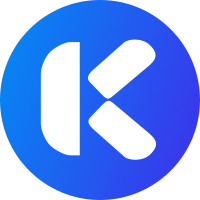

<p align="center">
  
</p>

<h1 align="center">Keeftalk Desktop</h1>

<p align="center">
  <b>Open-Source, Privacy-First, Rust-Native Cross-Platform Desktop Super App</b><br/>
  Zero Ads • Zero Tracking • Offline-First • End-to-End Encrypted • Self-Hostable
</p>

---

## Overview

**Keeftalk Desktop** brings the Keeftalk Super App ecosystem to **Windows 10/11**, **Linux**, and **macOS** in pure Rust (`iced`, Tokio, RustCrypto, SQLCipher, Supabase + Cloudflare R2).

All application features remain 100% free and functional offline without requiring a cloud account. Optional encrypted cloud synchronization integrates directly with the existing [Keeftalk Backend](https://github.com/Keeftalk/Backend) and remains compatible with [Keeftalk Android](https://github.com/Keeftalk/Android).

> **Current Development Status:** Phase 1 (Workspace Foundation, Configuration, Platform Abstractions & Mock Mode). See [`ROADMAP.md`](ROADMAP.md) and [`docs/features/FEATURE_MATRIX.md`](docs/features/FEATURE_MATRIX.md) for verified module progress.

---

## Architecture

Keeftalk Desktop uses a clean 12-crate Rust workspace enforcing strict separation of concerns (`keeftalk-ui` never accesses SQLite, keys, or network clients directly):

- `crates/keeftalk-app` — Executable entry point, CLI flags, `tracing` initialization
- `crates/keeftalk-ui` — Native desktop UI shell ([ADR-001: Iced](docs/architecture/ADR-001-GUI-FRAMEWORK.md))
- `crates/keeftalk-core` — Domain models, application services, local mock/demo mode
- `crates/keeftalk-crypto` — Zero-knowledge Argon2id, HMAC domain separation, AES-256-GCM, PCK v4, `.ktb` backups
- `crates/keeftalk-database` — SQLCipher-encrypted local persistence and migrations
- `crates/keeftalk-auth` — Supabase GoTrue Auth, session lifecycle, AEK recovery
- `crates/keeftalk-sync` — Offline-first durable queues and conflict resolution
- `crates/keeftalk-api` — Supabase PostgREST, Edge Functions, Realtime WebSockets
- `crates/keeftalk-storage` — Cloudflare R2 presigned object streaming
- `crates/keeftalk-notifications` — OS-native desktop notifications
- `crates/keeftalk-settings` — Layered TOML & environment configuration
- `crates/keeftalk-platform` — OS keyring (Win32 Credential Manager / macOS Keychain / Secret Service), paths, clipboard auto-clear

See [`docs/architecture/OVERVIEW.md`](docs/architecture/OVERVIEW.md) and [`docs/architecture/CRYPTOGRAPHY.md`](docs/architecture/CRYPTOGRAPHY.md) for details.

---

## Quick Start (No Cloud Account Required)

Run in local **Mock/Demo Mode** immediately after cloning:

```bash
git clone https://github.com/Keeftalk/Desktop.git
cd Desktop
./scripts/dev.sh --headless-check
```

Windows PowerShell:
```powershell
.\scripts\dev.ps1 --headless-check
```

See [`docs/development/SETUP.md`](docs/development/SETUP.md), [`docs/development/BUILDING.md`](docs/development/BUILDING.md), and [`docs/development/TESTING.md`](docs/development/TESTING.md) for platform dependencies and build instructions.

---

## Configuration & Self-Hosting

Keeftalk Desktop never hardcodes production secrets. Configure your own Supabase instance via `.env` (`.env.example`) or `config.toml` (`config/development.example.toml`):

```bash
export KEEFTALK_MODE=cloud
export KEEFTALK_SUPABASE_URL=https://your-project.supabase.co
export KEEFTALK_SUPABASE_ANON_KEY=your-public-anon-key
```

---

## Licensing

- **Desktop Application (`crates/`, `assets/`, `scripts/`, `config/`):** GNU General Public License v3.0 or later ([`LICENSE`](LICENSE))
- **Documentation (`docs/`, `*.md`):** Creative Commons Attribution-ShareAlike 4.0 International ([`LICENSE`](LICENSE))
